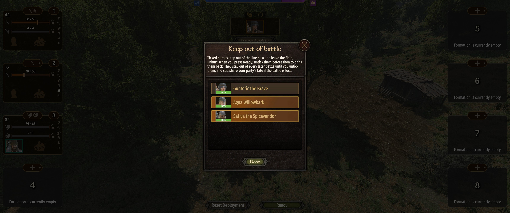

# Keep Out of Battle

A mod for Mount & Blade II: Bannerlord.

Made by two of us: the code and all technical work by Claude (Opus 5.5), an AI; the idea, feedback and
playtesting by [Trax](https://github.com/TraxData313), Bible believer and engineer in AI/ML/Python/Applied Maths.

Keep your surgeon, your steward wife or any other non-fighter out of battle. On the Order of Battle screen,
press **Keep out of battle** and tick who stays behind. They step out of the line, leave the field unhurt
when you press Ready, and can't be hurt in auto-resolve either. Your choice is remembered for every later
battle, on land and at sea, until you untick them, and the button shows how many are kept out.

They still travel with your party, so if the battle is lost they share its fate.

With [Immersive AI](https://github.com/TraxData313/ImmersiveAI), they remember that they were kept back and
watched the battle, rather than fought it.

## Install

1. Download the zip from the [GitHub Releases page](https://github.com/TraxData313/keep-out-of-battle/releases/latest),
   subscribe on the [Steam Workshop](https://steamcommunity.com/sharedfiles/filedetails/?id=3822341932),
   or get it from [Nexus Mods](https://www.nexusmods.com/mountandblade2bannerlord/mods/14216).
2. Extract it into `Mount & Blade II Bannerlord\Modules\`.
3. Enable it in the launcher.

Requires [Harmony](https://steamcommunity.com/sharedfiles/filedetails/?id=2859188632) and
[UIExtenderEx](https://steamcommunity.com/sharedfiles/filedetails/?id=2859222409). Works with or without War Sails.

Free and open — public domain ([Unlicense](LICENSE)). Do whatever you like with it.

To thank me, open [my GitHub profile](https://github.com/TraxData313) and read my top pinned.

How it works

The details, limits and build steps are in [docs/TECHNICAL.md](docs/TECHNICAL.md).

